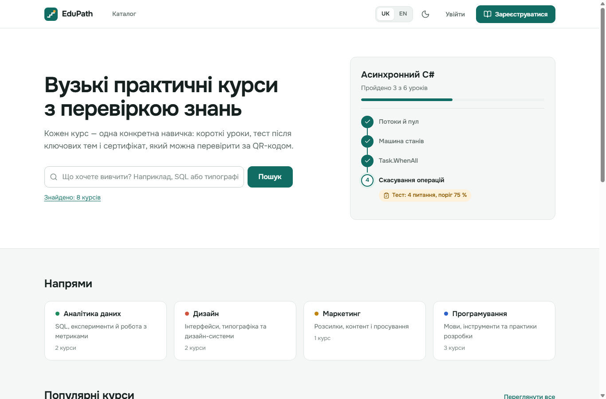
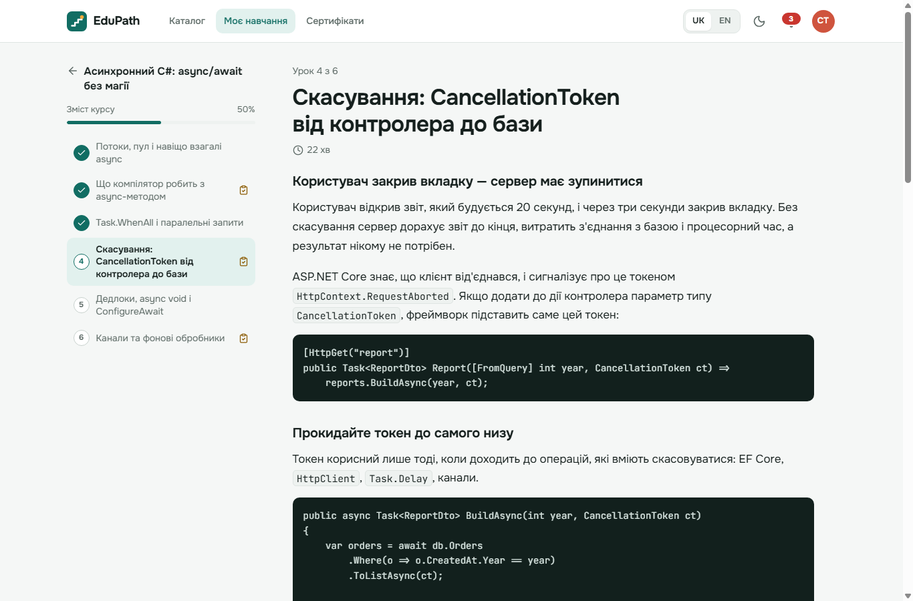
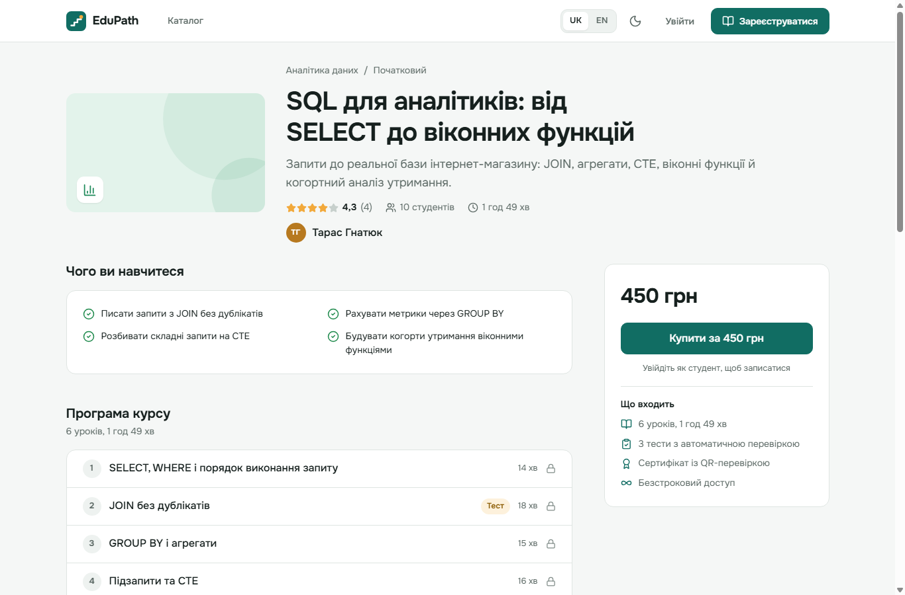
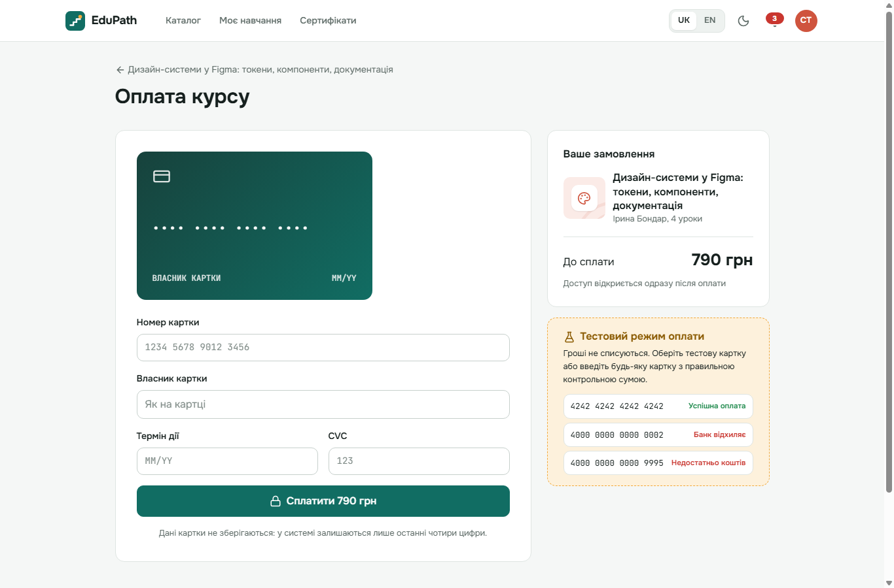
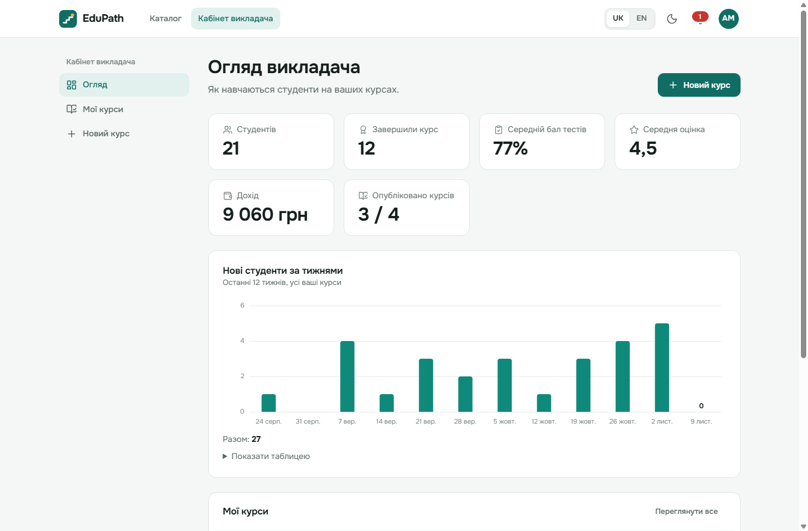
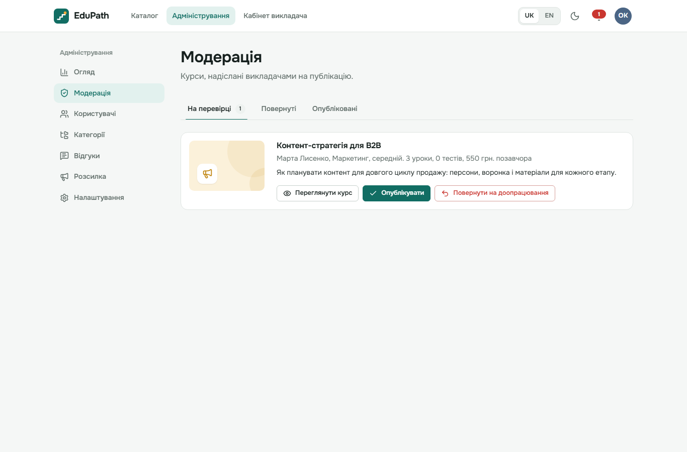
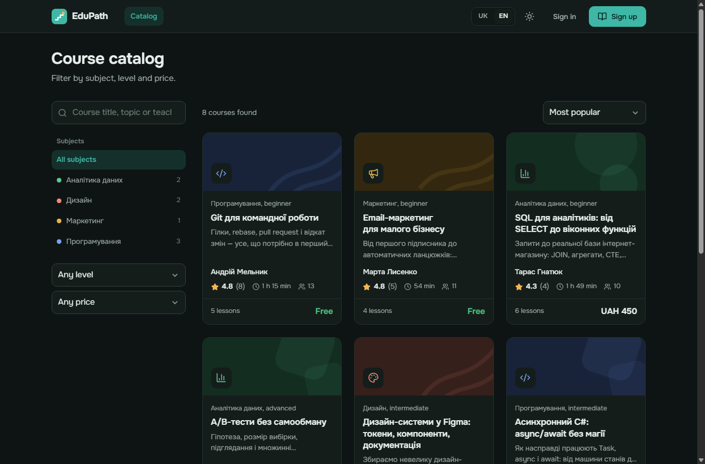
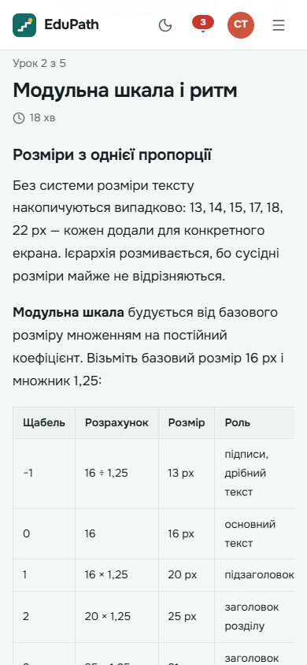

# EduPath

EduPath — вебплатформа вузьких практичних курсів. Кожен курс складається з коротких уроків і тестів після ключових тем. Наприкінці студент отримує сертифікат, справжність якого можна перевірити за QR-кодом.

Платформа має три кабінети (студент, викладач, адміністратор), платні й безкоштовні курси з тестовою оплатою, модерацію, сповіщення в реальному часі, аналітику та повну локалізацію EN/UK. Архітектуру спроєктовано за UML-моделлю з 13 діаграм; відповідність діаграм коду наведено [нижче](#відповідність-діаграмам).



| Шар | Технології |
|---|---|
| Frontend | React 19, TypeScript, Vite 7, React Router 7, TanStack Query, react-hook-form + zod, CSS Modules |
| Backend | ASP.NET Core (.NET 10), EF Core 10, FluentValidation, JWT, SignalR |
| База даних | SQLite у розробці, PostgreSQL у Docker |
| Інфраструктура | Docker, docker compose, nginx, GitHub Actions |

---

## Зміст

- [Скриншоти](#скриншоти)
- [Швидкий старт](#швидкий-старт)
- [Як користуватися](#як-користуватися)
- [Тестова оплата](#тестова-оплата)
- [Архітектура](#архітектура)
- [Тести](#тести)

---

## Скриншоти

| | |
|---|---|
|  |  |
| Урок: Markdown, код, тести після теми | Сторінка курсу з програмою й відгуками |
|  |  |
| Оплата тестовою карткою | Кабінет викладача зі статистикою |
|  |  |
| Черга модерації адміністратора | Каталог: темна тема, англійська мова |

<p align="center">
  
</p>

---

## Швидкий старт

```bash
git clone https://github.com/Andrew543210/dotnet-react-EduPath-learningPlatform.git
cd dotnet-react-EduPath-learningPlatform
```

### Варіант 1. Docker (PostgreSQL)

```bash
docker compose up --build
```

Відкрийте http://localhost:8080. Compose піднімає три контейнери:

- `db` — PostgreSQL 17;
- `api` — ASP.NET Core; при старті застосовує міграції й наповнює базу демо-даними;
- `web` — nginx роздає зібраний React і проксіює `/api`, `/files` та WebSocket `/hubs` на API.

Для розгортання поза локальною машиною скопіюйте `.env.example` у `.env` і задайте власні `POSTGRES_PASSWORD` та `JWT_SIGNING_KEY`.

### Варіант 2. Локально (SQLite)

Потрібні **.NET SDK 10** і **Node.js 22+**.

API:

```bash
cd backend/src/EduPath.Api
dotnet run --launch-profile http
```

API запуститься на http://localhost:5080. Під час першого старту створюється база `App_Data/edupath.db` з демо-даними. Інтерактивна документація API (Scalar) — http://localhost:5080/docs.

Фронтенд в іншому терміналі:

```bash
cd frontend
npm install
npm run dev
```

Відкрийте http://localhost:5173. Vite проксіює `/api`, `/files` і `/hubs` на API.

---

## Як користуватися

Під час першого запуску база наповнюється демо-даними: каталог із курсами, викладачі, студенти з прогресом, оплати, відгуки, сертифікати й сповіщення. Усі графіки та статистика одразу показують живі цифри.

### Облікові записи

Пароль для всіх облікових записів: **`Demo12345`**.

| Роль | Email | Що є в акаунті |
|---|---|---|
| Студент | `student@edupath.dev` | завершений курс із сертифікатом, два курси в процесі, історія оплат, сповіщення |
| Викладач | `teacher@edupath.dev` | 4 курси: три опубліковані й чернетка; статистика, студенти, відгуки |
| Адміністратор | `admin@edupath.dev` | курс у черзі модерації, користувачі, категорії, відгуки, розсилка, налаштування |

Додаткові викладачі з тим самим паролем: `iryna.bondar@edupath.dev` (має курс, повернений модератором із коментарем), `taras.hnatiuk@edupath.dev`, `marta.lysenko@edupath.dev` (має курс на перевірці). Ще 24 студенти з адресами `@example.com` створюють статистику записів, проходжень і відгуків.

### Курси

| Курс | Викладач | Ціна | Статус |
|---|---|---|---|
| Асинхронний C#: async/await без магії | Андрій Мельник | 690 грн | опублікований |
| Git для командної роботи | Андрій Мельник | безкоштовно | опублікований |
| TypeScript: типи, що ловлять баги | Андрій Мельник | 590 грн | опублікований |
| Типографіка для інтерфейсів | Ірина Бондар | 490 грн | опублікований |
| Дизайн-системи у Figma: токени, компоненти, документація | Ірина Бондар | 790 грн | опублікований |
| SQL для аналітиків: від SELECT до віконних функцій | Тарас Гнатюк | 450 грн | опублікований |
| A/B-тести без самообману | Тарас Гнатюк | 650 грн | опублікований |
| Email-маркетинг для малого бізнесу | Марта Лисенко | безкоштовно | опублікований |
| Контент-стратегія для B2B | Марта Лисенко | 550 грн | на модерації |
| Кольорові палітри для брендів | Ірина Бондар | 390 грн | повернений на доопрацювання |
| Docker для .NET-розробника | Андрій Мельник | 520 грн | чернетка |

Уроки — повноцінні тексти з прикладами коду, таблицями й практичними завданнями. Вони лежать у Markdown-файлах у `backend/src/EduPath.Infrastructure/Persistence/Seed/Content` і вбудовуються в збірку як ресурси.

### Сценарії для знайомства

**Студент** (`student@edupath.dev`)

1. «Моє навчання» → продовжіть курс «Асинхронний C#» з четвертого уроку й складіть тест після нього.
2. Каталог → «Дизайн-системи у Figma» → «Купити». Спершу введіть картку `4000 0000 0000 0002`, щоб побачити відмову банку, потім `4242 4242 4242 4242`.
3. «Сертифікати» → сертифікат курсу Git → відскануйте QR-код або відкрийте сторінку перевірки `/verify/<номер>`.
4. Залиште відгук на сторінці курсу, який проходите, і перегляньте сповіщення під дзвіночком.

**Викладач** (`teacher@edupath.dev`)

1. «Огляд» — студенти, дохід, середній бал і графіки за тижнями.
2. «Новий курс» → опис у Markdown, уроки з матеріалами, тест із питаннями → «Надіслати на модерацію».
3. Відкрийте курс → «Студенти»: прогрес кожного, воронка проходження уроків, повідомлення студентам.

**Адміністратор** (`admin@edupath.dev`)

1. «Модерація» → курс «Контент-стратегія для B2B»: опублікуйте його або поверніть із коментарем.
2. Відкрийте в іншому браузері кабінет `marta.lysenko@edupath.dev` — сповіщення про рішення прийде в реальному часі.
3. «Користувачі» — зміна ролі й блокування, «Відгуки» — модерація, «Розсилка» — оголошення для всіх або окремої ролі.

### Скидання даних

- Локально: зупиніть API й видаліть `backend/src/EduPath.Api/App_Data` — під час наступного старту база створиться заново.
- У Docker: `docker compose down -v`, потім `docker compose up`.

### Три рівні доступу

- **Студент:** каталог, запис на курс, оплата, уроки, тести, сертифікати, відгуки, сповіщення.
- **Викладач:** усе для власних курсів — редактор опису (Markdown), уроки з матеріалами, тести, подання на модерацію, статистика й воронка проходження, повідомлення студентам.
- **Адміністратор:** модерація курсів (схвалити або повернути з коментарем), керування ролями й блокуванням, категорії, модерація відгуків, розсилки, системні налаштування. Має також доступ до кабінету викладача.

Доступ перевіряється на сервері (політики авторизації за роллю й власником курсу) і дублюється на клієнті: гостя переадресовує на вхід, користувачу з чужою роллю показується сторінка 403.

---

## Тестова оплата

Зовнішні платні сервіси емульовано, гроші ніде не списуються.

| Номер картки | Результат |
|---|---|
| `4242 4242 4242 4242` | успішна оплата |
| `4000 0000 0000 0002` | банк відхилив картку |
| `4000 0000 0000 9995` | недостатньо коштів |
| `4000 0000 0000 0069` | термін дії картки минув |
| `4000 0000 0000 0127` | неправильний CVC |

Будь-який інший номер, що проходить перевірку Луна, вважається успішним. Термін дії вводиться у форматі `MM/YY` і не має бути простроченим; CVC — 3–4 цифри.

Номер картки перевіряється двічі: на клієнті (алгоритм Луна, тип картки, термін дії, CVC) і на сервері. Після оплати в базі лишаються тільки останні 4 цифри та ідентифікатор транзакції вигляду `pi_…`.

| Сервіс на архітектурній схемі | Чим замінено |
|---|---|
| Stripe (Payment Gateway) | `SandboxPaymentGateway` — правила тестових карток і затримка, як у справжнього шлюзу |
| SendGrid (Email) | `LoggingEmailSender` — листи пишуться в лог |
| AWS S3 (Cloud Storage) | `LocalFileStorage` — файли зберігаються в `App_Data/files` і віддаються за підписаними посиланнями з терміном дії, як presigned URL у S3 |

Кожна заміна реалізує інтерфейс з `Application/Abstractions`. Щоб підключити справжній сервіс, достатньо зареєструвати іншу реалізацію в DI — бізнес-логіку змінювати не потрібно.

---

## Архітектура

```
backend/
  src/
    EduPath.Domain          сутності з діаграми класів, інваріанти, машина станів навчання
    EduPath.Application     сценарії (сервіси за діаграмою компонентів), DTO, валідація, абстракції
    EduPath.Infrastructure  EF Core (SQLite/PostgreSQL), міграції, JWT, емуляції зовнішніх сервісів, демо-дані
    EduPath.Api             REST-контролери, SignalR-хаб, обробка помилок, локалізація EN/UK
  tests/
    EduPath.UnitTests        домен і інфраструктура
    EduPath.IntegrationTests API повністю, через WebApplicationFactory
frontend/
  src/
    api/        клієнт REST і типи DTO
    app/        роутер, провайдери, макети
    auth/       сесія, охоронці маршрутів за роллю
    i18n/       словники uk/en, плюралізація, форматування
    ui/         власна бібліотека компонентів (кнопки, поля, модалки, тости)
    features/   курси, навчання, графіки, сповіщення, відгуки, редактор курсу
    pages/      сторінки: public / student / teach / admin
```

Залежності спрямовані всередину (Clean Architecture): `Api → Application → Domain`, а `Infrastructure` реалізує абстракції з `Application`. Доменна логіка не залежить ні від EF Core, ні від ASP.NET.

### Відповідність діаграмам

| № | Діаграма | Де в коді |
|---|---|---|
| 1 | Архітектурна схема | рівні: React (користувацький), Application-сервіси (сервісний), `Infrastructure/External` (інтеграційний), Docker і PostgreSQL (інфраструктурний) |
| 2 | Прототип інтерфейсу й навігація | `frontend/src/app/router.tsx` — усі екрани зі схеми, окремі розділи `/teach` і `/admin` |
| 3 | Алгоритм внутрішніх процесів | `LearningService`, `TestingService`, `PaymentService`: перевірка користувача → дія → збереження → оновлення прогресу |
| 4 | Алгоритм взаємодії користувача | вхід → каталог → курс → (оплата для платного) → уроки → тест з порогом → повторна спроба або результат → сертифікат |
| 5 | Use Case | ролі `Student`, `Teacher`, `Admin` і політики авторизації; кожен сценарій має свій ендпоінт і сторінку |
| 6 | Діаграма класів | `EduPath.Domain`: User, Course, Category, Lesson, Enrollment, Test, Question, StudentAnswer, TestResult, Payment, Certificate, Notification (+ Review, SystemSettings) |
| 7 | Комунікації | оплата → `Enrollment.Activate` → `Lesson` → `Test.CalculateScore` → `TestResult` → `Certificate.Generate` через доменні події |
| 8 | Послідовності | `PaymentService.CheckoutAsync` → `IPaymentGateway` → Enrollment; `TestingService.SubmitAsync` рахує й зберігає результат |
| 9 | Стани проходження курсу | `Domain/Learning/LearningStateMachine.cs` і статуси `Enrollment` (Pending → Active → Completed) та `Payment` |
| 10 | Діяльності | ті самі гілки рішень: помилка входу, невдала оплата, тест нижче порогу, є наступний урок / курс завершено |
| 11 | Компоненти | Authentication, Course (`CatalogService`, `CourseAuthoringService`), Testing, Payment, Certificate, Notification Service; Cloud Storage і Payment System — інтерфейси з емуляціями |
| 12 | Розгортання | `docker-compose.yml`: Web Server (nginx + SPA), Application Server (API), Database Server (PostgreSQL), том для «хмарного сховища» |
| 13 | Пакети | Presentation = `EduPath.Api` + `frontend`; Authentication/Courses/Testing/Payments/Certificates/Notifications = папки в `Application`; Persistence і External Integrations = `Infrastructure` |

### Що додано понад діаграми

- **Модерація курсів:** Draft → PendingReview → Published / Rejected (з коментарем) → Archived.
- **Відгуки й рейтинги** з розподілом оцінок; адміністратор може видалити недоречний відгук.
- **Сповіщення в реальному часі** (SignalR) з дзвіночком і тостами; запасний варіант — періодичне опитування.
- **Сертифікат із QR-кодом** і публічна сторінка перевірки `/verify/:номер`; друк або збереження в PDF.
- **Аналітика:** тижневі графіки студентів і доходу, воронка проходження уроків, статистика платформи.
- **Двомовність EN/UK:** інтерфейс, повідомлення сервера (`Accept-Language`), сповіщення, формати дат і грошей.
- **Світла й темна теми** (з урахуванням системного налаштування), адаптивна верстка до 360 px, доступність: skip-link, фокус, ARIA, таблиці-альтернативи для графіків.
- **Безпека:** хешування паролів PBKDF2; JWT, який перестає діяти одразу після блокування або зміни ролі; rate limiting на вході й оплаті; підписані посилання на матеріали платних курсів; білий список типів файлів і `nosniff` + `CSP sandbox` для завантажених файлів; ProblemDetails замість стек-трейсів.
- **Надійність оплати:** лише одна оплата курсу може оброблятися одночасно (унікальний частковий індекс), збій шлюзу або обірваний запит не блокують повторну спробу.

---

## Тести

Backend — unit та інтеграційні тести:

```bash
cd backend
dotnet test
```

Frontend — компонентні тести, лінтер і production-збірка:

```bash
cd frontend
npm test
npm run lint
npm run build
```

- **Backend unit:** доменні інваріанти (стани запису, оцінювання тестів, модерація, видача сертифіката), шлюз оплати, хешування паролів, повнота перекладів повідомлень.
- **Backend integration:** повні сценарії через HTTP — реєстрація та вхід, доступ за ролями, оплата тестовими картками, проходження курсу до сертифіката, модерація, локалізація помилок.
- **Frontend:** перевірки карток (Луна, термін дії), паритет словників uk/en і плюралізація, охоронці маршрутів за роллю, сторінка входу, оформлення оплати, API-клієнт.

CI (`.github/workflows/ci.yml`) запускає все це на кожен push і pull request, а також збирає Docker-образи.

---

## Ліцензія

[MIT](LICENSE)
